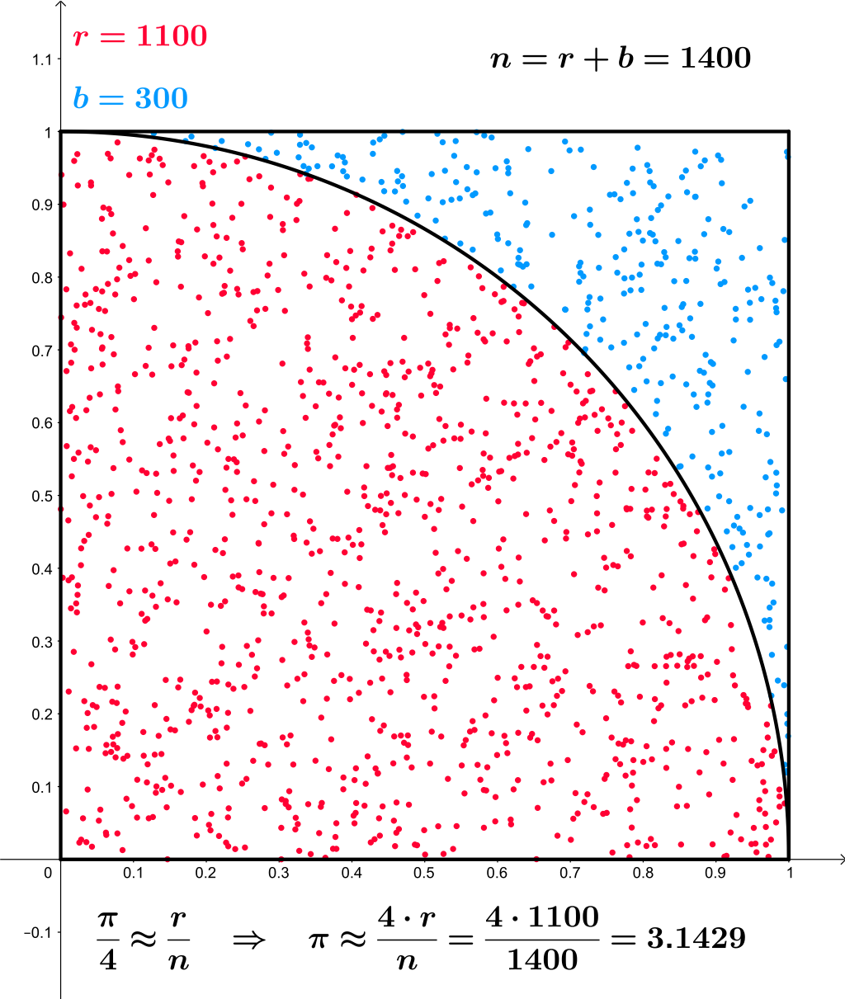

:sectnums:
:nofooter:
:toc: left
:icons: font
:data-uri:
:source-highlighter: highlightjs

= Ava.03 -- Calculate stem:[pi]

When creating a desktop client we gain two main advantages:

. Full access to the host
** Access files
** Run commands like `git clone`
** => not possible in a browser sandbox
. Access to the vast resources of the host
** Multithreading to use multiple CPU cores
** Using gigabytes of RAM if needed
** => not (easily) possible in a browser

This time we are going to take advantage of the latter to calculate stem:[pi] with an approximation technique.

TIP: Some unit tests have been provided, but due to the interconnectedness of the various parts of a GUI application, there are many compile errors to fix before the application will even compile

== stem:[pi] Approximation

We are going to use the https://en.wikipedia.org/wiki/Monte_Carlo_method[Monte Carlo method] to approximate the value of stem:[pi].
The idea is to randomly generate points in a 1x1 square and count how many fall inside a quarter circle inscribed within that square.
The ratio of the area of the quarter circle to the area of the square is equal to stem:[pi/4].

We will do this in four ways:

. Sequentially, single threaded
. Sequentially, multi-threaded
. Vectorized, single threaded
. Vectorized, multi-threaded

== `PiCalculation` Class

The basics idea is to draw random numbers between 0 & 1 of which two represents the x and y coordinates of a point in the unit square.
Then, you only need to check if the point lies within the quarter circle, which is done by checking if the distance to the origin is less than or equal to 1.

NOTE: The full calculation would be stem:[sqrt(x^2+y^2) <= 1], but in the unit circle we can simplify that to stem:[x^2+y^2 <= 1^2] and that to stem:[x^2+y^2 <= 1] to avoid the square root operation, which is expensive

Repeat that for the number of experiments you want to run, then plug into the formula stem:["pointsInside"/"experiments"*4] and you have your approximation of stem:[pi].

If delegates for progress and/or experiment result reporting are provided, call them at the appropriate times with the respective values.
However, for the progress reporting we limit ourselves to 200 updates _over the whole _ simulation run -- which is still plenty for the progress bar and reduces the overhead of reporting between experiments.

== `PiCalculationSIMD` Class

Working with https://learn.microsoft.com/en-us/dotnet/standard/simd[SIMD] (single instruction, multiple data) is _not_ trivial, and it is easy to make mistakes.
Thus, I have already provided the implementation for you.
Try to read through the code and understand what is going on -- it should be similar to the sequential version you implemented, just doing 2-8 experiments at once.

=== Performance

Obviously, writing vectorized code is more complicated, so why would you do it?
As usual, the answer is performance.
Doing e.g. 4 `float64` multiplications at once instead of one at a time would net you a 400% speedup just by making use of modern hardware features 😎

Except that it doesn't, at least not by itself.
Vectorize exactly the interesting-looking part -- stem:[x^2+y^2 <= 1] -- and the result is actually _slower_ than the plain scalar loop 😲🤯

==== The Trap: Amdahl's Law

The rule that decides whether an optimization is worth anything is https://en.wikipedia.org/wiki/Amdahl%27s_law[Amdahl's law]: speeding up a part of a program is capped by how much of the total runtime that part actually is.

Measure the scalar implementation piece by piece and you find:

* drawing the two random numbers: ~52% of the time
* loop overhead, tuple returns and the virtual call into `IRandomProvider`, millions of times: ~35% of the time
* the multiply, add and compare we were so proud of vectorizing: ~13% of the time

So 87% of the runtime was never touched by the vectorization.
Vectorizing the remaining 13% by a factor of ~3.6 gives you, at absolute best:

[stem]
++++
1/((1-0.13) + 0.13/3.6) approx 1.10
++++

A 10% ceiling -- and, getting the random numbers one by one and buffering via `stackalloc`, with some additional overhead it would be _slower_ than the unoptimized version.

CAUTION: This is the actual takeaway -- micro-optimizing the part that _looks_ expensive, without profiling first, is how you end up with more complicated code that is not faster

==== Fixing It: Vectorize the Whole Pipeline

If the random numbers are the bulk of the work, then the random numbers are what has to be vectorized.
The BCL's `Random` cannot do that, so `RandomProvider` implements https://prng.di.unimi.it/[xoshiro256+] itself -- a PRNG that is a handful of shifts and XORs, which `Vector<T>` supports just fine.
Have a look at `RandomProvider`, it is worth understanding:

* The generator exists twice, as a scalar and as a vectorized version, running the exact same algorithm.
That is what makes comparing the two simulations fair: the only difference is how many numbers come out per step.
* The vectorized state is `Vector<ulong>` instead of `ulong`, so every _lane_ is an independent stream of random numbers
* Turning random bits into a `double` in stem:[[0, 1)] is done with a bit trick rather than an integer-to-float conversion
** Stuffing 52 random bits into the mantissa of an exponent-0 double yields a value in stem:[[1, 2)], and subtracting 1 moves it to stem:[[0, 1)]

.Why not just convert the integer to a double?
[%collapsible%]
====
Because `long` -> `double` is not a single instruction below AVX512DQ, so the JIT has to emulate it and you lose most of what you gained.
The bit trick is pure shifts and ORs, which every SIMD instruction set has had for decades.
====

Two more details in `PiCalculationSIMD` itself are worth a look:

* The `insideCircle` counter is accumulated _lane-wise_ in a `Vector<long>` and folded into a single number only once, after the loop.
A horizontal sum per iteration costs more than the comparison we are vectorizing.
* The `stackalloc` buffers are only touched when experiment result reporting is switched on -- in the hot path the vectors go straight from the generator into the math

With that, on my machine (AVX2, so `Vector<double>.Count` = 4), one thread, no reporting:

[cols="3,>1,>1"]
|===
| | ns per experiment | vs. scalar

| scalar simulation | ~4.8 | 1.00x
| vectorized simulation | ~1.9 | *~2.5x*
| naive SIMD (scalar generator + vectorized math) | ~4.8 | ~1.00x
|===

TIP: Note what is _not_ there: a 4x speedup, even though we have 4 lanes.
Random number generation is still 66% of the vectorized run and does not scale perfectly, and the per-iteration bookkeeping (cancellation check, progress accounting) does not scale at all.
Amdahl's law does not stop applying just because you did the right thing!

==== Consequences

Vectorizing the generator is not free of trade-offs, and both of them show up in the unit tests:

* Each lane draws from its own stream, so the vectorized run consumes a _different_ sequence of random numbers than the scalar one. Same seed, same algorithm, different result -- and since the number of lanes depends on the CPU, the vectorized result is not even reproducible across machines.
`PiCalculationTests` therefore pins exact values only for the scalar version and checks convergence towards stem:[pi] for the vectorized one.
* A fast PRNG is a few words of mutable state with no locking whatsoever, so it is _not_ thread-safe.
Every worker needs its own instance, which is why `IRandomProvider` is registered as _transient_.

=== Keyed Services

We have _two_ implementation of the `IPiCalculation` interface -- how could we make use of both and _know_ which one we get?
One solution is to use https://learn.microsoft.com/en-us/dotnet/core/extensions/dependency-injection#keyed-services[keyed services] with dependency injection.
Take a look at `CoreSetup` to see how to register services with a key and _resolve_ the one you need in the `Runner` implementation (read the documentation to learn how to do that). 

== Runner

The `Runner` class is responsible for running the experiments by starting the requested number of threads with `IPiCalculation` implementations and combining the results.

A method to batch the number of experiments has been provided.
Also take a look at `RunProgressCounter` which can be helpful to _aggregate_ the current total progress when using _multiple threads_.

Complete the implementation -- `Task.WhenAll` is your friend here 😉

== Experiment Renderer

We create a dedicated `ExperimentRenderer` user control to render a bitmap with the experiment results.
Mind, that after a couple of hundred experiments all will look the same, because an e.g. 200x200 pixel bitmap can only show a very limited number of points.
Using a larger bitmap will result in a higher resolution -- you are free to try that, the code _should_ scale the rendering automatically.

The control and writing pixel data into a `WriteableBitmap` is not trivial and thus, has already been implemented for you => take a look and understand how it works.
*Especially the part where we _subscribe_ to the `PropertyChanged` event of the view model _in code_!*

Now, you are tasked with completing the view model implementation.
Here are a couple of requirements:

* Do _not_ send updated data (via property changed) to the view for _every_ experiment, that would slow things down a lot!
* Instead, cache/buffer the result data in the view model and only update the observable property once `RenderResults` is called
* But we have to be even more careful: 100000000000 experiment results with the full 2x `double` + 1x `bool` values for coordinates and in-circle result will not only exceed the maximum capacity of any collection, but also likely blow up your RAM
** Round the coordinates to 3 decimal places -- plenty of resolution for the bitmap, but limits the number of distinct points to 1000x1000 = 1 million
** With only 3 decimal places a `float` has sufficient precision and storing the values as `float` instead of `double` will save you 8 bytes per experiment result
* And on top of that, we have potentially multiple threads writing to the same collection, so we need to make sure that we are thread-safe
* Try to figure out how to use a `ConcurrentDictionary` to store the results while making sure that a _smart_ hash code implementation is used to so that points very close to each other will have the same hash code after rounding
** Hint: use an efficient data type for the keys (based on the coordinates) and store the color as the value
** Values for existing keys can simply be overwritten
* Try to understand how the color is encoded within a single `int` value, while I already provided the code it is definitely worth understanding how it works    

== Main Window

The main part of the application.
You have to implement both the view as well as the view model, making use of the parts you implemented so far and satisfying the following requirements:

=== View Model

* Not much logic, but has to provide all the properties for the various inputs, toggles, labels, buttons, etc. of the view
* Also contains a `ExperimentRendererViewModel` property to later bind to the `ExperimentRenderer` control => has to call its values accordingly in the delegates passed to the `Runner`
** Mind, that operations which modify the view have to run on the UI thread -- https://docs.avaloniaui.net/docs/guides/development-guides/accessing-the-ui-thread[read the documentation] to learn how to do that
* All properties have to be updated accordingly to represent the current state of the application
** That includes setting the `CanExecute` of commands so that *buttons are disabled* when they should not be clickable
* Required properties:
** Renderer view model
** Max threads -- determined via `Environment.ProcessorCount` and different for each machine
** Min threads -- at least 1
** Current number of threads to use
** Progress reporting enabled/disabled
** Result rendering enabled/disabled
** Vectorized calculation enabled/disabled
** Number of experiments to run -- make sure no invalid values are set
*** Hint: hooking into the change event to sanitize the value is a good idea
** Current progress value (0-1)
** Result text (approximated value of stem:[pi])
** Elapsed time text (formatted as `hh:mm:ss:fff`)
** Flag indicating if the toggles can be used (not possible while running)
** Label values for experiments & threads with proper pluralization
* Required commands:
** Start the simulation
*** Has to reset the previous results and start a new simulation with the current settings
*** A challenge is to provide appropriate delegates for the `Runner` to report progress and results -- if set to 'on'
*** Can be called while the simulation is not running
** Stop (cancel) the simulation
*** Aborts the current simulation run
*** Can be called while the simulation is running
* Make sure to use a `CancellationTokenSource` and pass the token to the `Runner` so that the simulation can be _cleanly_ cancelled
* Take the system time when the simulation starts and calculate the elapsed time when the runner is finished

NOTE: A few unit tests have been provided for the view models as well, to demonstrate that thanks to the MVVM pattern they can be tested without the UI.
In fact creating a `Bitmap` during a unit test wouldn't even work, because that requires platform dependent code to be executed.

=== Testing the View Model

Two details in `MainWindowsViewModelTests` look wrong at first glance, but are very much on purpose.
Both boil down to the same fact: in a unit test there is no running Avalonia application and therefore nobody is pumping the dispatcher's job queue.

==== Why the command is not awaited (immediately)

[source,csharp]
----
var execution = sut.StartCalculationCommand.ExecuteAsync(null);

sut.StartCalculationCommand.CanExecute(null).Should().BeFalse();
sut.StopCalculationCommand.CanExecute(null).Should().BeTrue();

resultTrigger(3.14D);
await execution;
----

The mocked `IRunner` does not return a finished task, it returns the task of a `TaskCompletionSource` which is only completed later, when the test calls `resultTrigger(3.14D)`.
That is the whole point of the mock: it lets us freeze the view model _in the middle of a run_ and assert the "running" state -- start button disabled, stop button enabled -- before we let the simulation finish.
Awaiting the command right away would therefore hang the test forever, because the only thing that can complete it is a line we would never reach.

==== Why `Invoke` and not `InvokeAsync`/`Post`

`Dispatcher.UIThread.InvokeAsync(...)` and `Dispatcher.UIThread.Post(...)` only _enqueue_ the action; it runs whenever the dispatcher gets around to processing its queue.
`Dispatcher.UIThread.Invoke(...)` on the other hand dispatches _synchronously_: if the caller already is on the UI thread the action just runs inline, otherwise the caller blocks until it has run.

In the real application all three work, because a message loop drains that queue continuously -- in a unit test nobody does, so an enqueued action is simply never executed.
`Invoke` still works: since no `Application` was ever started, `Dispatcher.UIThread.CheckAccess()` returns `true` for the test thread and the action runs inline.

That is exactly what the last assertion of the test relies on:

[source,csharp]
----
sut.ResultValue.Should().Be("3.14");
----

Swap the `Invoke` in `RunOnUIThread` for `InvokeAsync` (or `Post`) and this assertion fails -- `ResultValue` is still empty, because the assignment is sitting in a queue nobody drains.

CAUTION: Take this as a warning, not as a recipe 😉
The test only passes because the test thread _happens_ to be treated as the UI thread.
To test code that genuinely posts to the dispatcher, run a dispatcher in the test instead of bending the production code -- e.g. with `Avalonia.Headless.XUnit` or `Dispatcher.UIThread.RunJobs()`.

=== View

No code behind logic needed here, but many different controls -- include our custom made one -- to set up and position correctly.
Make sure your application looks very similar to the one shown in the <<sec:sample_run,sample run>>.

==== Parent view model binding

Because binding in XAML is... witchcraft and often not very intuitive, here is a sample on how to bind to a property of the parent view model if the `DataContext` for a child control has been set -- by default it would bind to the _child's_ view model!?

[source,xaml]
----
<controls:ExperimentRenderer Grid.Row="0"
                                DataContext="{Binding RendererViewModel}"
                                IsVisible="{Binding $parent.((vm:MainWindowViewModel)DataContext).RenderResults, FallbackValue={x:False}}" />
----

Three parts are important here:

. We need to access the parent data context using `$parent`
. We need to cast it to access its properties, because all data contexts are of type `object`
. We should provide a fallback value in case some casting or binding fails

==== `IntToDoubleConverter`

For the slider you will need to convert `int` to `double` values. 
Do some research (yes, on your own) on how value converters work in XAML and then implement and use the `IntToDoubleConverter`.

== Sample Run [[sec:sample_run]]

Here is a sample run of the complete application showcasing various runs with different parameters:

video::pics/sample_run.mp4[Sample Run]
