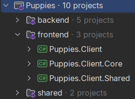

:sectnums:
:nofooter:
:toc: left
:icons: font
:data-uri:
:source-highlighter: highlightjs

= Ava.05 -- 🐶 Adoption Agency -- Part II

I'm sure you guessed it by now: with direct database access being such a bad idea, this time you will adapt the puppy adoption program from the previous assignment to use an ASP.NET REST API instead.

The good news is, that _no_ new functionality has to be added.
Also, our infrastructure is mostly in place -- you only need to change the services in the client to use the REST API instead of the database.
All views can stay the same and for the view models you only need to remove the transaction management (which is now handled properly server-side).

The code for the backend is also mostly already there.
For example, the repositories can be used as they are.
The services can also be adapted easily.
The major addition are the REST API controllers and DTOs.

However, without a little challenge this would be boring.
Here are the _new_ concepts you will have to figure out this time:

== Advanced Solution Structure

Client & Server use the same  language & framework => *we can _share_ code*!

* Create _one_ solution containing all client & server projects
** To keep things structured on disk, remember that project folders do _not_ have to be siblings of the solution file, but can be grouped into sub folders
** Find a consistent naming scheme, that allows e.g. to have a `Core` project for both server and client
** Very useful are _solution folders_ which can be added in Rider (and even Visual Studio) as _virtual_ (= do not have to exist on disk, but may) folders to add another level of structure
+

* Use _shared_ projects which contain the DTOs (and potentially other shared code) -- reference those in both client and server projects

TIP: With a shared API contract (requests, responses, DTOs), one could even share the _validators_ and validate on the client before even sending the request to the server 😲

== `HttpClient` Usage

You need to make HTTP requests _from_ the C# client to the API

* For this task a `HttpClient` is used, _but_, because it uses native resources, we need to be careful
** Creating `new HttpClient()` in a loop is an easy way to exhaust system resources in no time -- in case you ever want to do that 😉
* Luckily, the `HttpClientFactory` exists, which handles creation, _pooling_ and disposal of the clients for us -- we only need to configure it correctly
* And when we are already configuring a client, we can even create a *named* one which has a certain base URL (and potentially default headers (auth,...)) set up automatically
** For this task make sure you have the `Microsoft.Extensions.Http` package added to the project in which you want to register the client
** Then use the `AddHttpClient` on your `IServiceCollection` and pass two pieces of data:
... The _name_ of the client (e.g. `PuppyApiClient`).
This name will later be needed again, so maybe put it into a constant.
... A lambda which allows you to configure the client.
In this case it is sufficient to set the `BaseAddress` property to the base URL of the API (e.g. `http://localhost:5200/api/`).
This information will come from the _application settings_, so you need to access the configuration here!
** Wherever you want to use the client
... First, inject an `IHttpClientFactory`
... Then, call its `CreateClient` method, passing the name of the client -- cache this client in a field and reuse it for all requests
* For requests some handy extension methods are defined:
** `GetFromJsonAsync<T>()` to get a JSON object from the API and deserialize it into an object of type `T`
** `PostAsJsonAsync<T>()` to send a JSON object to the API and deserialize the response into an object of type `T`
*** There are also `PutAsJsonAsync<T>()` and `PatchAsJsonAsync()` etc. methods
** If you are interested in the _response_, e.g. to check the `StatusCode` property or a header, then use the `GetAsync`, `PostAsync`, `DeleteAsync` etc. methods
*** You can still access the payload in a second step, by using `ReadFromJsonAsync<T>` on the `Content` property of the response
** *Important:* _all_ methods which handle JSON (de)serialization require you to pass `JsonSerializerOptions` so that the client knows which format the server expects for requests and uses for responses
*** Maybe these options can be _shared_ between client and server 🤔

Here is a base class I used for all _client_ services which might give you some insights:

.ServiceBase.cs
[source,csharp]
----
/// 

///     Base class for all services in the application
/// 

internal abstract class ServiceBase(IHttpClientFactory httpClientFactory)
{
    private static readonly Duration artificialDelay = Duration.FromSeconds(0.6D);

    private static readonly Lazy<JsonSerializerOptions> jsonOptions = new(() =>
    {
        var options = new JsonSerializerOptions(JsonSerializerOptions.Web);
        JsonConfig.ConfigureJsonSerialization(options, false);

        return options;
    });

    /// 

    ///     HTTP client used to communicate with the API
    /// 

    protected HttpClient ApiClient { get; } = httpClientFactory.CreateClient(Setup.ApiClientName);

    /// 

    ///     JSON serialization options used for API requests and responses
    /// 

    protected static JsonSerializerOptions JsonOptions => jsonOptions.Value;

    /// 

    ///     Adds an artificial delay to simulate network or database latency
    /// 

    protected static async ValueTask DelayAsync()
    {
        await Task.Delay((int) artificialDelay.TotalMilliseconds);
    }
}
----

== Easier Client DI

Thanks to getting rid of the direct database access, it is no longer necessary to worry about scopes and different `DbContext` instances for all view models.
Not only makes that the code in the services (now moved to the backend) simple, it also allows us to clean up the client code a bit.

* Get rid of `ScopedWindow` & `ScopedControl` => no longer needed, the regular base classes `Window` & `UserControl` are sufficient
* That also means, that we no longer have to worry about the disposal of the view models
* Services can be registered as singletons

The view model creation logic can also be simplified:

.App.axaml.cs
[source,csharp]
----
internal static T CreateViewModel<T>() where T : ViewModelBase
{
    if (_serviceProvider is null)
    {
        throw new InvalidOperationException("Service provider is not initialized");
    }
    
    var viewModel = ActivatorUtilities.CreateInstance<T>(_serviceProvider);

    return viewModel;
}
----

== Tasks

. Adapt you previous solution to no longer access the database directly, but move that logic to a server and then call the REST API from the client
** To do that, create _one_ solution with multiple solution folders
** Share code between client and server, e.g. DTOs, validators, etc.
** We created many ASP.NET backends last year, so this is pure repetition
. Get rid of the 'scoped' aspects in the client
. Properly perform HTTP requests in the client
. Because we now have a backend again, this is a good moment to also repeat writing _integration tests_ => do just that and test your API endpoints

In the end, the application should work exactly the same as before, but now with a proper backend API.

=== Simplifications

* We keep the image processing client side (to waste user resources instead of precious server resources), but at the same time make sure that the backend does not accept images larger than 1MB during request validation
* We assume that server and client are always in the same time zone, so simply using `LocalDate` will still work -- otherwise we'd have to use `Instant` and convert at both ends
